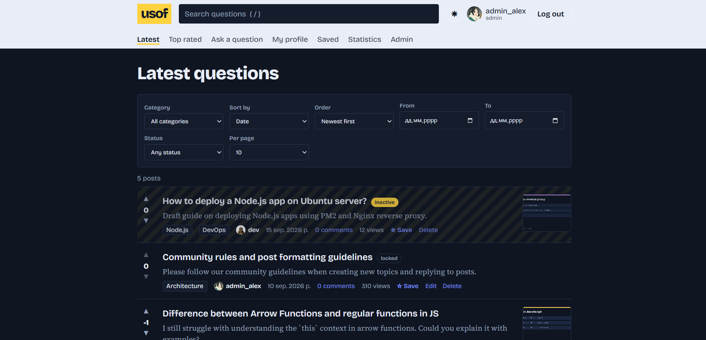
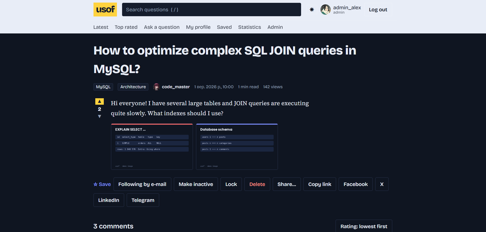
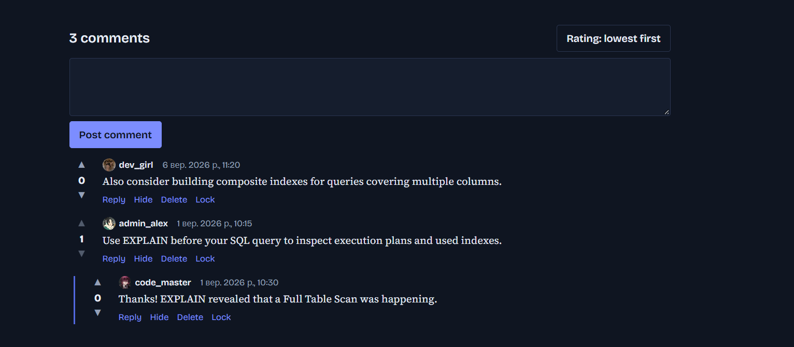
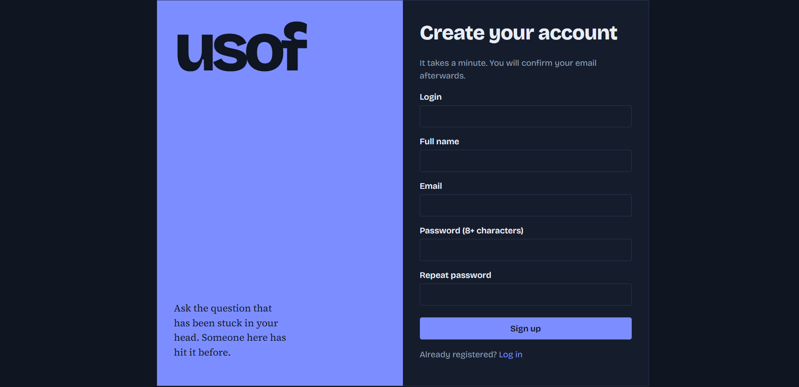
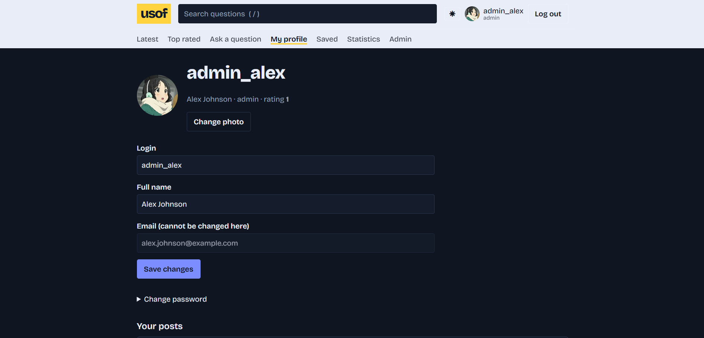
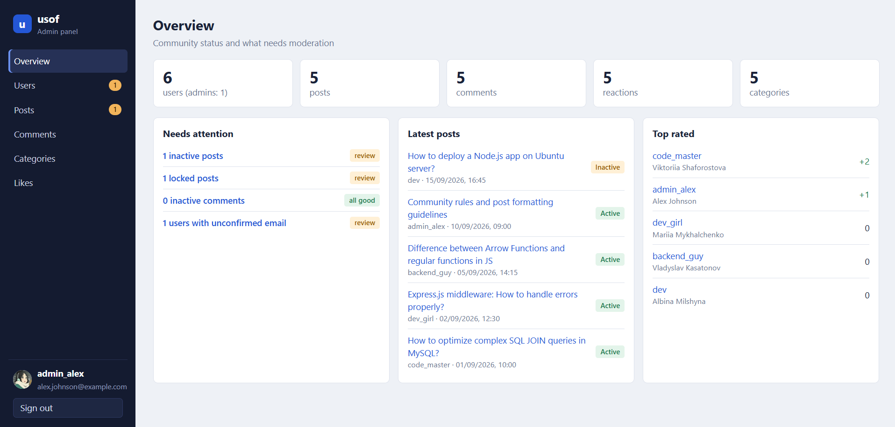

# usof — questions and answers for developers

Full Stack track, challenge **usof frontend** (second part of the usof project).
A React + Redux single-page app (Create React App) on top of the **usof backend** REST API (Express + MySQL, folder `API/`).

## What it does
- Registration with e-mail confirmation, log in / log out, password reset.
- Main page with the latest posts; sorting (date / rating), filtering (category, date interval, status), search, pagination with a changeable page size. Every control lives in the URL, so a filtered list can be shared.
- Post page: images, likes/dislikes, nested comments (comments on comments), comments sorted by rating, favourites, e-mail subscription, view counter, reading time.
- Profile page: edit login / full name, upload an avatar, list of the user's posts with their own sorting and filters.
- **Statistics page** (`/#/stats`): totals, a 30-day activity chart (questions, comments, views), popular categories, like/dislike ratio, top members and most viewed questions. Charts are plain SVG, no chart library.
- **Admin panel inside the app** (`/#/admin`, admins only): overview with "needs attention" counters, users (edit data, roles, e-mail confirmation, delete), posts (hide/show, lock, change categories, delete), comments (hide, lock, delete), categories (create, edit, delete), reactions. One login for the whole site. Hiding a post as an admin also locks it, so its author cannot simply show it again.
- **Photos** are added one by one (or several at once) with a preview and a remove button for each, up to 5 per post; they can also be added and removed when a post is edited.
- Authors can hide and show their own posts; the profile page has a change-password form.
- Sharing: native share sheet, copy link, Facebook, X, LinkedIn, Telegram.
- Light / dark theme with a toggle (remembers the choice), "/" focuses the search box, "Skip to content" link, responsive layout.
- Validation of every form with readable messages.

## Screenshots
| Main page (filters, pagination) | Post | Comments |
|---|---|---|
|  |  | 

| Registration | Profile | Admin panel |
|---|---|---|
|  |  |  |

## Requirements
- Node.js 18+ (20 or 22 recommended) and npm
- MySQL 8 (for the API); `API/docker-compose.yaml` starts one with `docker compose up -d`

## How to run
```bash
git clone <your-repository-url>
cd <repository>

# 1. Database (MySQL 8 in Docker, port 3306). Wait ~30 s until the log says "ready for connections"
cd API
docker compose up -d

# 2. API (port 3000)
npm install
npm start
cd ..

# 3. Web app (port 5173) - from the repository root
npm install
npm start
```
The dev server proxies `/api`, `/uploads` and `/admin` to `http://localhost:3000`
(see `web/src/setupProxy.js`; another address: `API_URL=http://host:port npm start`).
The port 5173 is set in `web/.env.development` (the API builds e-mail links from `CLIENT_URL=http://localhost:5173`).
Production build: `npm run build` → `web/build/` (static files; the app uses a hash router, so any static host works).

Test admin from the seed data: `admin_alex` / `Password123`. Without SMTP settings the confirmation and reset links are printed in the API console.

`API/.env` is never committed (JWT secret, mail password); `API/.env.example` lists every variable.

## API notes for reviewers
All routes start with `/api`. Request bodies can be JSON or `application/x-www-form-urlencoded` (plain `curl -d`).

| Task | Request |
| --- | --- |
| Register | `POST /auth/register` (`login`, `email`, `password`, `passwordConfirmation`) |
| Change a password | `PATCH` or `PUT /users/:id` with `password` (optional `passwordConfirmation`, `currentPassword`) |
| Admin creates / deletes a user | `POST /users`, `DELETE /users/:id` |
| Hide a post (author or admin) | `PATCH /posts/:id` with `status=inactive` |
| Comment on a comment | `POST /comments/:id/reply` |
| Add photos to a post | `POST /posts/:id/images` (multipart field `images`, 5 per post) |
| Remove a photo | `DELETE /posts/:id/images/:image_id` |
| Statistics, view counter | `GET /stats`, `POST /posts/:id/view` |

Only an admin can delete other users' comments; authors can delete their own. Demo photos and avatars for the seed data live in `API/uploads/posts` and `API/uploads/avatars` and are committed on purpose; files uploaded at run time are ignored by git.

## Project structure
```
package.json           thin root wrapper: `npm install` / `npm start` / `npm run build` are forwarded to web/
API/                   usof backend (own package.json, .env.example, docker-compose.yaml)
  src/admin/           the old stand-alone admin panel served by the API (optional)
web/                   React app (Create React App)
  package.json         dependencies of the web app
  public/index.html    HTML template
  src/
    index.js           entry point
    setupProxy.js      dev-server proxy to the API (/api, /uploads, /admin)
    api/client.js      the only file that knows the API contract
    store/             Redux Toolkit slices: auth, feed, favorites, stats, ui
    components/        reusable UI pieces (Feed, PostCard, Comments, Reactions, ...)
    pages/             one component per route (pages/admin/ holds the admin tabs)
    router.jsx         small hash router (no third-party router)
docs/screenshots/      screenshots used by this README
```

## Behaviour worth knowing
- Comments are sorted by rating, **ascending by default** (as the brief says); the button above the list flips the order. Every level of the tree is sorted separately.
- You cannot like or dislike your own comment: the buttons are disabled in the UI and the API answers `403`.
- Date filters (From / To) are applied only when the date is complete (year 1970-2100), so typing the year by hand works.

## Algorithm of the program
1. `index.js` mounts `<App/>` inside the Redux `Provider`.
2. `App` restores the session from the JWT in `localStorage` (`restore`), loads categories and picks the page for the current `#/path`.
3. `Feed` reads filters from the URL, calls `fetchFeed` and renders `PostCard`s with `Pagination`; changing a control changes the URL, which triggers a new request.
4. `PostPage` loads the post and a flat list of comments; `Comments` builds a tree by `parentId` and sorts each level by rating.
5. Likes, favourites, locks and subscriptions are sent to the API and update only the affected component.
6. A `401` answer clears the token and sends the user to the login page.
7. `PostPage` counts one view per browser session (`POST /api/posts/:id/view`); `Stats` reads `GET /api/stats`; `Admin` renders the tab chosen in `?tab=` and loads it through `/api/admin/*`.

## Progress after each CBL stage
**Engage.** Big idea: an interface for the usof API. Essential question: how is a frontend for an API different from an ordinary site's frontend? Answer we worked out: the UI has no content of its own, so every screen is a view of API data (loading, empty and error states are part of the design) and every endpoint of the backend challenge needs a visible control. Challenge: build the second step of the usof project as a React app.

**Investigate.** We compared single-page and multi-page apps and chose an SPA, researched common web vulnerabilities (XSS, CSRF, token theft) and the frontend's part in preventing them (React escapes output, no `dangerouslySetInnerHTML`, token only in requests to our own API, input validation), compared pagination types and picked numbered pagination with a changeable page size, because the URL then describes the page and can be shared. We set up a Create React App project, Redux Toolkit for state and a small own hash router instead of a third-party one (third-party frameworks are forbidden). Planning the architecture first (URL as the source of truth for filters, one API client file) paid off later in the Creative part.

**Act: Basic.** Header with service name, search, role/login/avatar and menu on every page; main page with the latest posts, sorting, filtering and pagination; profile page with editable data and the user's own posts; post page with nested comments (comments on comments) sorted by rating; validation of every form.

**Act: Creative.** Statistics page with SVG charts, light/dark theme, sharing (native, copy link, Facebook, X, LinkedIn, Telegram), favourites, e-mail subscriptions, view counter, footer, an admin panel inside the app.
